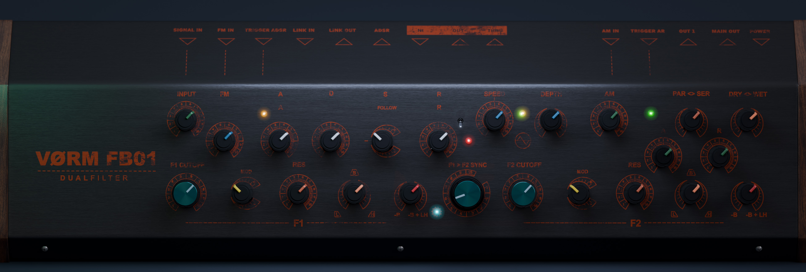

# vørm fb01

**Analog filtering. Powerful saturation. Hands-on control.**

vørm fb01 is an audio effect by **verstaerker** that authentically models an analog dual filter with powerful saturation. Developed through extensive measurements and direct listening comparisons, its sound model captures the interaction of input drive, resonance and modulation.

Shape drums, synths and textures with subtle movement, resonant sweeps or intense distortion.

*Dark interface variant preview.*

## Features

- Two continuously blendable Multimode Filters with parallel/serial routing and an adjustable Out1/Main mix.
- Nonlinear input drive, saturation and signal-dependent resonance.
- FM and AM with internal sources and external sidechain inputs.
- ADSR, AR and Envelope Follower with audio and MIDI triggering.
- LFO modulation from slow movement into audio rate, plus Harmonics sync.
- Optional character controls: noise, hum, FM bleed and Out1 asymmetry.
- Preset browser, A/B comparison, custom Init settings and MIDI Learn with controller profiles.
- Gain Match, Wet Level, output limiter/clipper, stereo-width control and selectable processing quality up to 384 kHz.
- Appearance Gain and Gamma from 0.80 to 1.30, with project recall and defaults for new instances.
- Optional compact interface with unchanged control sizes, alongside Bright, Dark and Flat themes.
- Linked knob pairs: Cmd-drag on macOS or Ctrl-drag on Windows, preserving their relative offset.

## Platforms

- **macOS 12+**: Apple Silicon and Intel; AU, VST3 and CLAP.
- **Windows 10/11 x64**: VST3 and CLAP.
- **Linux x86_64 beta**: VST3, LV2 and CLAP; built on Ubuntu 22.04, X11 editor. Other distributions and real DAW setups need testing.
- Host sample rates from 32 to 192 kHz, including 44.1 and 48 kHz.
- English and German interface and guides.

## Downloads — 0.27.6 beta

- **[macOS — AU, VST3 and CLAP, Apple Silicon / Intel](https://github.com/verstaerkermusic/vorm-fb01/releases/download/v0.27.6/VORM-fb01-0.27.6-macOS-universal.zip)**
- **[Windows x64 — VST3 and CLAP](https://github.com/verstaerkermusic/vorm-fb01/releases/download/v0.27.6/VORM-fb01-0.27.6-Windows-x64-beta.zip)**
- **[Linux x86_64 beta — VST3, LV2 and CLAP](https://github.com/verstaerkermusic/vorm-fb01/releases/download/v0.27.6/VORM-fb01-0.27.6-Linux-x86_64-beta.tar.gz)**

See the [release page](https://github.com/verstaerkermusic/vorm-fb01/releases/tag/v0.27.6) for SHA256 checksums, the [English guide](https://github.com/verstaerkermusic/vorm-fb01/releases/download/v0.27.6/VORM_fb01_Quick_Guide_EN.pdf), [German guide](https://github.com/verstaerkermusic/vorm-fb01/releases/download/v0.27.6/VORM_fb01_Schnellanleitung_DE.pdf) and [one-page flyer](https://github.com/verstaerkermusic/vorm-fb01/releases/download/v0.27.6/VORM_fb01_Flyer_EN.pdf).

Quit your DAW before installing. Follow **README.txt in your platform package** and keep only one copy of each plug-in ID in the scan folders. Back up/remove old copies when updating.

**macOS:** extract the complete ZIP and run `Install-VORM-fb01.command`. The beta is ad-hoc signed and not notarized. If macOS blocks it, attempt to open it, then use **System Settings > Privacy & Security > Open Anyway**. No developer tools are required.

**Windows:** copy the complete VST3 bundle and/or CLAP file to your plug-in folders and rescan.

**Linux:** copy the complete bundles to `~/.vst3/` and `~/.lv2/`, and the CLAP file to `~/.clap/`. The GUI uses X11; Wayland sessions may use XWayland. This first Linux beta has passed automated checks on Ubuntu 22.04; wider DAW testing is still needed.

The PDF guides describe the controls; their installation Quick Start covers macOS. Use the package README for Windows/Linux installation.

## What's included

Revised Bright and Dark graphics plus the new Flat theme; corrected LED glow and intermediate-frame blending. Gain and Gamma in Settings adjust the rendered interface from 0.80 to 1.30, with neutral 1.00 and a reset. Appearance and compact view are saved per project and can be remembered for new instances. The HiDPI fix keeps the editor at its full size after appearance changes. Audio processing is unchanged.

Read the [release notes](CHANGELOG.md) for details. Automated audio, MIDI, state and GUI checks passed; real DAW, controller and sidechain testing remains important.

## Feedback

Please [open an issue](https://github.com/verstaerkermusic/vorm-fb01/issues) and include your plug-in version, DAW, operating system, plug-in format, sample rate, buffer size and steps to reproduce the problem.

## Support

If you enjoy the project, you can [buy me a coffee](https://buymeacoffee.com/verstaerker).

This repository contains the project page, interface previews and release information. The plug-in source code is not published here.

## How this mas made
Using AI i was able to crate my own plugin. I'm no programmer but i'm an experienced music-producer and CG-artist. 
So developed this with the help of chatGPT. The GUI was created with traditional 3D rendering skills, AI helped to implement it into the plugin.  
