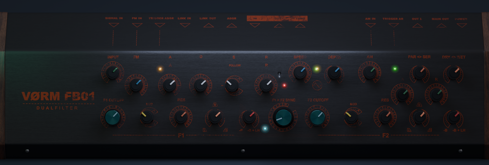

# vørm fb01

**Analog filtering. Powerful saturation. Hands-on control.**

vørm fb01 is an audio effect by **verstaerker** that authentically models an analog dual filter with powerful saturation. Developed through extensive measurements and direct listening comparisons, its sound model captures the interaction of input drive, resonance and modulation.

Shape drums, synths and textures with subtle movement, resonant sweeps or intense distortion.

*New Dark interface preview. Bright and Dark graphics are rendered; integration into the next plug-in build is in progress.*

## Features

- Two continuously blendable Multimode Filters with parallel/serial routing and an adjustable Out1/Main mix.
- Nonlinear input drive, saturation and signal-dependent resonance.
- FM and AM with internal sources and external sidechain inputs.
- ADSR, AR and Envelope Follower with audio and MIDI triggering.
- LFO modulation from slow movement into audio rate, plus Harmonics sync.
- Optional character controls: noise, hum, FM bleed and Out1 asymmetry.
- Preset browser, A/B comparison, custom Init settings and MIDI Learn with controller profiles.
- Gain Match, Wet Level, output limiter/clipper, stereo-width control and selectable processing quality up to 384 kHz.
- Linked knob pairs: Cmd-drag on macOS or Ctrl-drag on Windows, preserving their relative offset.

## Platforms

- **macOS 12+**: Apple Silicon and Intel; AU, VST3 and CLAP.
- **Windows 10/11 x64**: VST3 and CLAP.
- Host sample rates from 32 to 192 kHz, including 44.1 and 48 kHz.
- English and German interface and guides.

## Downloads

The next beta is being prepared under the new name. No plug-in binaries are published in this repository yet.

## Feedback

Please [open an issue](https://github.com/verstaerkermusic/vorm-fb01/issues) and include your plug-in version, DAW, operating system, plug-in format, sample rate, buffer size and steps to reproduce the problem.

## Support

If you enjoy the project, you can [buy me a coffee](https://buymeacoffee.com/verstaerker).

This repository contains the project page, interface previews and release information. The plug-in source code is not published here.
